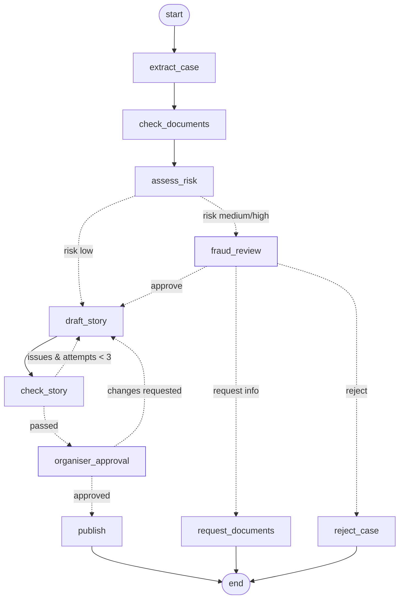

# CareFund — AI campaign agent for medical crowdfunding

A **LangGraph** agent that takes a patient's case from an organiser, verifies the documents, scores fraud risk, sends risky cases to a human reviewer, writes the fundraiser story with a self-correcting quality loop, gets the organiser's sign-off, and publishes a campaign page with a **LangChain RAG** assistant that answers donor questions.

**Live demo:** https://carefund-agent.vercel.app

Built for the kind of workflow platforms like ImpactGuru, Milaap and Ketto run every day: every campaign must be verified before it goes live, stories must be honest, and donors ask the same questions again and again.

## What the agent does



| Node | Type | What it does |
|---|---|---|
| `extract_case` | LLM (structured output) | Pulls category, plain-language condition, urgency, family situation and factual claims out of the form and free-text story into a Pydantic `CaseFacts` model |
| `check_documents` | Rules | Works out the required documents for the case type (e.g. transplant → authorisation committee approval) and cross-checks the pasted hospital estimate: hospital name, patient name, amount within 15% |
| `assess_risk` | Rules + LLM | 12 fraud rules (cost far above benchmark, goal above funding gap, personal UPI requests, unrelated organiser without authorisation, estimate mismatches, pressure language…) plus an LLM analyst that adds evidence-based concerns. Produces a 0–100 risk score |
| `fraud_review` | **Human-in-the-loop** | Graph pauses (`interrupt_before`). Reviewer approves, requests documents or rejects |
| `draft_story` | LLM | Writes a warm, factual campaign (title, share summary, story) with strict rules: no cure guarantees, no pressure, funds go to the hospital, ₹ amounts in Indian format |
| `check_story` | Rules | Validates the draft (names patient + hospital, states the goal, banned phrases, length) and **loops back** to `draft_story` with the issues, max 3 attempts |
| `organiser_approval` | **Human-in-the-loop** | Organiser approves or asks for changes, which go back into the draft |
| `publish` | Rules | Builds the campaign page and the donor knowledge base; status is `live` or `awaiting_documents` |

**Donor Q&A** (`carefund/donor.py`) is a LangChain chain: a custom `BaseRetriever` (BM25 with query expansion, light enough for serverless) → guardrail (refuses medical predictions like "will she recover?") → `ChatPromptTemplate | ChatGroq` answering only from retrieved facts, or handing the question to the organiser.

## Engineering notes

- **Stateless human-in-the-loop on serverless.** Vercel functions don't keep memory between requests, so the paused graph state is returned to the client. On resume the API rebuilds the graph and calls `update_state(config, state, as_node=<node before the checkpoint>)`; LangGraph then continues from the interrupted node without re-triggering the interrupt.
- **Graceful degradation.** Every LLM node falls back to deterministic logic if no API key is set or the LLM call fails, so the app always works. The UI shows which nodes ran on the LLM, rules or a human.
- **Tests** cover every path through the graph (clean → publish, risky → reject / request info / approve, organiser revisions, guardrails) and the LLM paths with a stub model: `pytest -q`.

## Stack

LangGraph 1.x · LangChain Core · langchain-groq (Llama 3.3 70B) · Pydantic · rank-bm25 · FastAPI · vanilla JS UI · Vercel

## Run locally

```bash
pip install -r requirements.txt
export GROQ_API_KEY=...        # optional; without it the agent runs in rules mode
uvicorn app:app --reload        # open http://localhost:8000
pytest -q
```

## API

| Method | Path | Body |
|---|---|---|
| POST | `/api/campaign/start` | `{form, documents[], estimate_text}` → `{state, paused_at}` |
| POST | `/api/campaign/resume` | `{state, paused_at, decision, note?, feedback?}` |
| POST | `/api/donor/ask` | `{question, knowledge_base[]}` |
| GET | `/api/meta` | samples, document labels, Mermaid graph |

The cost benchmarks are illustrative ranges for flagging outliers, not medical pricing. All people and documents in the samples are fictional.

---
Built by **Niket Korgaonkar** · [GitHub](https://github.com/NiKeT972)
