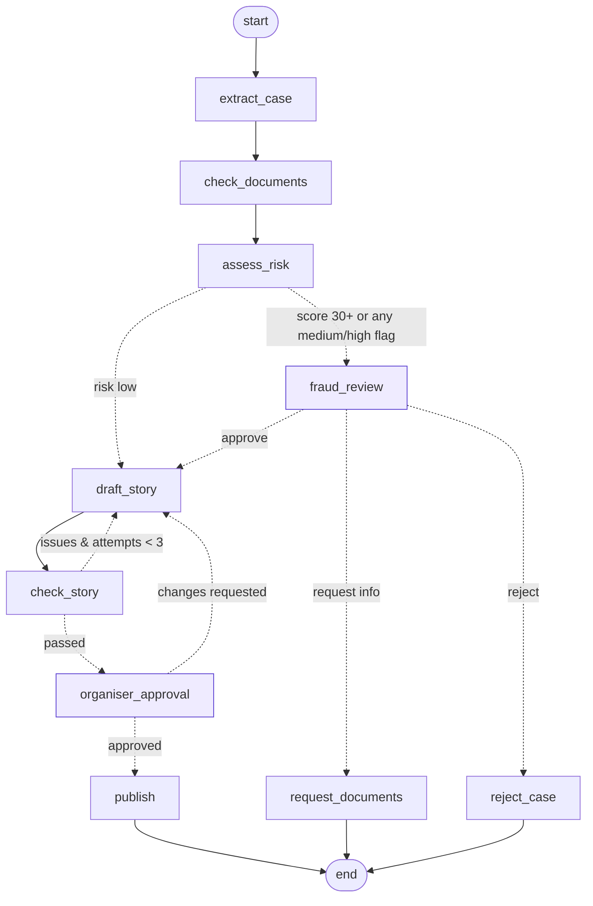

# CareFund — AI campaign agent for medical crowdfunding

[](https://github.com/NiKeT972/carefund-agent/actions/workflows/tests.yml)

A **LangGraph** agent that takes a patient's case from an organiser, verifies the documents, scores fraud risk, sends risky cases to a human reviewer, writes the fundraiser story with a self-correcting quality loop, gets the organiser's sign-off, and publishes a campaign page with a **LangChain RAG** assistant that answers donor questions.

**Live demo:** https://carefund-agent.vercel.app

Built for the kind of workflow platforms like ImpactGuru, Milaap and Ketto run every day: every campaign must be verified before it goes live, stories must be honest, and donors ask the same questions again and again.

## What the agent does



| Node | Type | What it does |
|---|---|---|
| `extract_case` | LLM (structured output) | Pulls category, plain-language condition, urgency, family situation and factual claims out of the form and free-text story into a Pydantic `CaseFacts` model |
| `check_documents` | Rules | Works out the required documents for the case type (e.g. transplant → authorisation committee approval) and cross-checks the pasted hospital estimate: hospital name, patient name, amount within 15% |
| `assess_risk` | Rules + LLM | 12 fraud rules (cost far above benchmark, goal above funding gap, personal UPI requests, unrelated organiser without authorisation, estimate mismatches, pressure language…) plus an LLM analyst that adds evidence-based concerns. Produces a 0–100 risk score; any medium/high flag goes to a human |
| `fraud_review` | **Human-in-the-loop** | Graph pauses (`interrupt_before`). Reviewer approves, requests documents or rejects |
| `draft_story` | LLM | Writes a warm, factual campaign (title, share summary, story) with strict rules: no cure guarantees, no pressure, funds go to the hospital, ₹ amounts in Indian format |
| `check_story` | Rules | Validates the draft (names patient + hospital, states the goal, banned phrases, length) and **loops back** to `draft_story` with the issues, max 3 attempts |
| `organiser_approval` | **Human-in-the-loop** | Organiser approves or asks for changes, which go back into the draft |
| `publish` | Rules | Builds the campaign page and the donor knowledge base; status is `live` or `awaiting_documents` |

**Donor Q&A** (`carefund/donor.py`) is a LangChain chain: a custom `BaseRetriever` (BM25 with query expansion, light enough for serverless) → guardrail (refuses medical predictions like "will she recover?") → `ChatPromptTemplate | ChatGroq` answering only from retrieved facts, or handing the question to the organiser.

## Shareable campaign page

When a campaign is published, the organiser gets a public link (`/c#<token>`) to share on WhatsApp. The token is the campaign signed with HMAC-SHA256, so:
- **No database needed:** the campaign travels in the link, and the server only checks the signature.
- **Can't be faked or edited:** change the goal, the hospital or a single fact in the link and the page shows "We couldn't verify this campaign".
- **Donor Q&A on the page reads facts only from the signed campaign**, so nobody can feed it made-up facts (such as a UPI ID).
- **The token sits in the URL fragment (after `#`),** which browsers don't send in the request line, so it stays out of server access logs.

Campaigns that are still waiting for documents are shown as "Verification pending"; rejected cases get no link.

## Evaluation

`python scripts/eval.py` runs the whole agent (rules mode with `--rules`, the LLM if `GROQ_API_KEY` is set) over hand-labelled data and writes `evals/report_<mode>.json`. The same numbers are shown in the app's **Evaluation** panel (`GET /api/eval`).

- `evals/cases.jsonl`: **32 campaigns**, 16 genuine and 16 that a fraud analyst would want to see (UPI and bank-transfer asks, including Hinglish ones; cost outliers; goals above the funding gap; estimates from another hospital; a friend organising without the family's letter; a 6-year-old in a "newborn" case…). Each is labelled with the category, whether it needs human review, the red flags that must be raised and the ones that must not. Labels were written before the agent was run on them.
- `evals/donor_cases.jsonl`: **20 donor questions**: answerable ones (with a phrase the answer must contain), ones the campaign can't answer, and medical questions the bot must refuse.
- **Task success** = a genuine case skips fraud review, its story passes every check and it publishes after approval; a suspicious case stops at fraud review **with** every labelled red flag raised.

| Metric (rules mode, no LLM) | First run | Now |
|---|---|---|
| Task success (end to end) | 71.9% | 100.0% |
| Suspicious cases sent to a human | 56.2% | 100.0% |
| Genuine cases wrongly held | 2 | 0 |
| Expected red flags raised | 95.5% | 100.0% |
| Medical category correct | 96.9% | 96.9% |
| Stories passing every check | 100.0% | 100.0% |
| Donor questions answered correctly | 81.8% | 100.0% |
| Says "I don't know" when it should | 100.0% | 100.0% |
| Medical questions refused | 80.0% | 100.0% |

What the first run found, and the general fixes (no case was special-cased):
- **Single red flags never reached a human.** A friend organising without the family's letter, a 6-year-old in a newborn case, or an estimate in someone else's name each scored 15, below the review threshold of 30. Now any medium or high flag goes to fraud review. Low flags (pressure language, LLM concerns) still only add up, so the LLM can't send cases to review on its own.
- **Genuine hospitals failed the estimate check** when the letterhead used another name ("MNJ Cancer Hospital" vs "MNJ Institute of Oncology", "ILBS"). The check now ignores generic words like *hospital* or *cancer* and accepts the acronym.
- **An account number was read as a ₹3,021 crore amount**, and "deposit in my SBI a/c" wasn't seen as a payment request. 9+ digit runs are no longer amounts; `a/c`, `NEFT`, `IMPS` and similar were added to the payment phrases.
- **Donor Q&A:** "isn't" left a stray "isn" word that nothing covered, and "treating" didn't match "treatment". Contraction pieces are now ignored and a small stemmer handles -ing/-ed/-ment. "Will the transplant work?" slipped past the medical guardrail, which only knew "the surgery".

The one category miss is a brain tumour, labelled *brain or spine* but classified as *cancer*. Either label is defensible, so the rules were left alone.

**Held-out check.** The rules were fixed against the same 32 cases they're scored on, so the "Now" column is optimistic. After the fixes I wrote 10 more cases (`evals/holdout.jsonl`) and ran them once: **80.0% task success**. They exposed one real bug: the payment and story checks used substring matching, so "upi" matched inside "J**upi**ter Hospital". That's fixed (whole-word matching) and the held-out score is now 90.0%. The remaining miss is "WhatsApp me for bank details", a payment request the phrase list doesn't catch; that's the kind of case the LLM analyst is there for.

`test_eval_rules_mode_does_not_regress` fails CI if fraud-review recall drops below 100%, a genuine case is held, or task success falls below 95%.

## Tracing with LangSmith

Set `LANGSMITH_TRACING=true` and `LANGSMITH_API_KEY` (and optionally `LANGSMITH_PROJECT=carefund`) and every graph run, node, LLM call and donor answer shows up in LangSmith as a trace. No code depends on it: LangChain and LangGraph read those variables themselves. Each run is named (`start_campaign`, `resume_campaign`, `donor_answer`) and tagged with metadata such as the checkpoint and the reviewer's decision, so you can filter, for example, every run that a reviewer rejected. `/api/health` shows `tracing: true` when it's on, and the tests force it off.

## Engineering notes

- **Stateless human-in-the-loop on serverless.** Vercel functions don't keep memory between requests, so the paused graph state is returned to the client. On resume the API rebuilds the graph and calls `update_state(config, state, as_node=<node before the checkpoint>)`; LangGraph then continues from the interrupted node without re-triggering the interrupt.
- **Tamper-proof paused state.** If the server trusted the state the browser sends back, an organiser could lower `risk_level` and skip fraud review. The paused state (and the checkpoint it paused at) travels inside an HMAC-SHA256-signed token (`carefund/state_token.py`); the API resumes only from tokens it signed and checks the decision is valid for that checkpoint. Set `STATE_SIGNING_KEY` in production.
- **Honest donor answers without an LLM.** BM25 always ranks *some* fact first, so in retrieval-only mode an answer is given only if a fact covers most of the question's meaningful words (with synonyms); otherwise the question goes to the organiser. A table of real donor questions in the tests checks both cases.
- **Graceful degradation.** Every LLM node falls back to deterministic logic if no API key is set or the LLM call fails, so the app always works. The UI shows which nodes ran on the LLM, rules or a human.
- **Tests** cover every path through the graph (clean → publish, risky → reject / request info / approve, organiser revisions, guardrails), the LLM paths with a stub model, and the eval thresholds: `pytest -q`.

## Stack

LangGraph 1.x · LangChain Core · langchain-groq (gpt-oss-120b by default, set with `GROQ_MODEL`) · Pydantic · rank-bm25 · FastAPI · vanilla JS UI · Vercel

## Run locally

```bash
python -m venv .venv && source .venv/bin/activate   # Windows: .venv\Scripts\activate
pip install -r requirements-dev.txt                 # app deps + pytest + uvicorn
cp .env.example .env                                # then put your GROQ_API_KEY in .env (optional; rules mode without it)
uvicorn app:app --reload                            # open http://localhost:8000
pytest -q
python scripts/live_check.py                        # with the server running: every review path + donor Q&A
python scripts/eval.py --rules                      # evaluation report (drop --rules to measure the LLM)
```

The key is read from `.env` via python-dotenv. Real environment variables take precedence, which is how Vercel supplies it.

## API

| Method | Path | Body |
|---|---|---|
| POST | `/api/campaign/start` | `{form, documents[], estimate_text}` → `{state, paused_at, token?}` |
| POST | `/api/campaign/resume` | `{token, decision, note?, feedback?}`: `token` comes from the paused response; decisions: `approve`/`request_info`/`reject` at fraud review, `approve`/`changes` at organiser approval |
| POST | `/api/donor/ask` | `{question, campaign_token}` (facts come from the signed campaign) |
| POST | `/api/campaign/view` | `{token}` → `{campaign, status, facts}` for the public page |
| GET | `/c#<campaign_token>` | Public, shareable campaign page |
| GET | `/api/meta` | samples, document labels, Mermaid graph |

The cost benchmarks are illustrative ranges for flagging outliers, not medical pricing. All people and documents in the samples are fictional.

---
Built by **Niket Korgaonkar** · [GitHub](https://github.com/NiKeT972)
